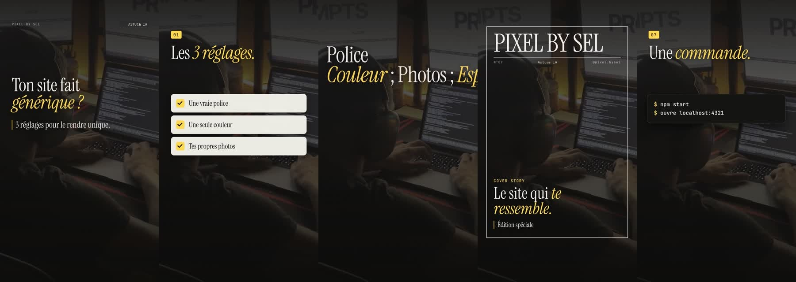
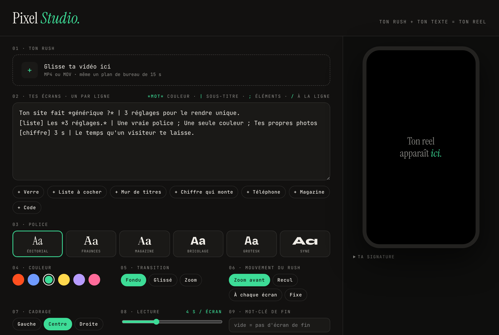

# Pixel Studio

**Ton rush + ton texte = ton reel.** Tu déposes une vidéo (un plan de bureau, ton écran, n'importe quel rush), tu écris un écran par ligne, et Pixel Studio sort un reel vertical 1080×1920, avec texte animé, effets et transitions. Pas de logiciel de montage, pas de timeline.



**Version web, sans installation : [ressources.pixelbysel.com/studio](https://ressources.pixelbysel.com/studio)** — aperçu en direct, export MP4 dans ton navigateur (Chrome, Edge ou Safari à jour).

Créé par [Selim · Pixel by Sel](https://pixelbysel.com) ([@pixel.bysel](https://instagram.com/pixel.bysel)) pour monter ses reels sans voix. Gratuit et open source (licence MIT).

## Comment ça marche

1. Ton texte devient une page web animée (HTML + CSS).
2. [Playwright](https://playwright.dev) ouvre cette page et la filme image par image, 30 fois par seconde, avec un fond transparent.
3. [ffmpeg](https://ffmpeg.org) recadre ton rush en 9:16, ajoute un léger mouvement de caméra et colle le texte par-dessus.

Tout tourne sur ton ordinateur : ta vidéo n'est envoyée nulle part.

## Version web (recommandée)

Ouvre [ressources.pixelbysel.com/studio](https://ressources.pixelbysel.com/studio), glisse ton rush, écris tes écrans : la vidéo se met à jour en direct. « Exporter » encode le MP4 dans ton navigateur (WebCodecs) : ta vidéo n'est envoyée sur aucun serveur. L'export dure à peu près la durée du reel.

Le code de la version web est dans [`web/`](web) : du JavaScript sans dépendance (moteur canvas) + [mp4-muxer](https://github.com/Vanilagy/mp4-muxer) (MIT). Pour l'héberger toi-même, sers le dossier `web/` avec n'importe quel serveur statique.

## Version locale (Node)

La première version, qui tourne sur ton ordinateur avec Playwright et ffmpeg.

### Installation

Il te faut **Node.js 18 ou plus** et **ffmpeg**.

| Système | ffmpeg |
|---|---|
| Mac | `brew install ffmpeg` |
| Windows | `winget install ffmpeg` |
| Linux | `sudo apt install ffmpeg` |

Puis, dans un terminal :

```bash
git clone https://github.com/PixelBySel/pixel-studio.git
cd pixel-studio
npm install
npm run setup     # télécharge le navigateur utilisé pour filmer (une seule fois)
npm start
```

Ouvre ensuite **http://localhost:4321**.



## Écrire ses écrans

Un écran par ligne. La première ligne est l'accroche.

| Syntaxe | Effet |
|---|---|
| `*mot*` | le mot passe en couleur (et en italique avec les polices à empattement) |
| `Titre \| sous-titre` | un titre et une phrase en dessous |
| ` / ` | retour à la ligne |
| `;` | sépare les éléments d'une liste, d'un mur ou d'une conversation |

### Effets

Ajoute le nom de l'effet entre crochets au début de la ligne (ou clique sur les boutons sous la zone de texte).

| Effet | Exemple |
|---|---|
| `[verre]` carte en verre | `[verre] Pas de *template.* \| Ton style, pas celui de tout le monde.` |
| `[liste]` liste qui se coche | `[liste] Les *3 réglages.* \| Une vraie police ; Une seule couleur ; Tes photos` |
| `[mur]` mur de titres | `[mur] Police ; *Couleur* ; Photos ; *Espace*` |
| `[chiffre]` chiffre qui monte | `[chiffre] 7 \| effets, une ligne de texte chacun.` |
| `[tel]` conversation dans un téléphone | `[tel] Il répond *en DM.* \| Tu fais comment ? ; Commente GUIDE ; Merci !` |
| `[magazine]` couverture de magazine | `[magazine] Le site qui *te ressemble.* \| Édition spéciale` |
| `[code]` commandes qui s'écrivent | `[code] Une *commande.* \| npm start ; ouvre localhost:4321` |
| `[ticket]` ticket de caisse qui s'imprime | `[ticket] Ta commande \| Site vitrine : 790 € ; Domaine : 12 € ; Total : 802 €` |
| `[tampon]` gros tampon qui s'abat | `[tampon] Refusé \| Ton site sans HTTPS ?` |
| `[commentaire]` un commentaire s'écrit et se publie | `[commentaire] GUIDE \| Comment recevoir le lien ?` |
| `[abonne]` bouton S'abonner → Abonné | `[abonne] Une astuce *par jour.* \| Pixel by Sel` |
| `[widgets]` widgets en verre qui flottent | `[widgets] *Mes stats.* \| 7 024 vues ; 107 visites ; 53 abonnés` |
| `[rebours]` compte à rebours 3, 2, 1 | `[rebours] *C'est parti.* \| Le reel commence` |

#### Effets avec la personne filmée (version web)

Pour ces effets, Pixel Studio repère la personne dans ton rush (détourage + visage) avec [MediaPipe](https://ai.google.dev/edge/mediapipe) de Google, directement dans ton navigateur. Les modèles (environ 1 Mo) se téléchargent la première fois ; ta vidéo n'est jamais envoyée. Marche mieux avec une personne de face, bien éclairée.

| Effet | Exemple |
|---|---|
| `[derriere]` un mot géant passe derrière toi | `[derriere] Claude \| Et le mot passe derrière toi` |
| `[projecteur]` le fond s'éteint, tu restes éclairé | `[projecteur] *Coupe les lumières.*` |
| `[cible]` un viseur se verrouille sur ton visage | `[cible] *Cible repérée.* \| Le viseur suit ton visage` |
| `[zoomvisage]` zoom rapide sur ton visage | `[zoomvisage] *Écoute bien.*` |
| `[orbite]` des cartes tournent autour de ta tête | `[orbite] Mes outils \| Claude ; Vercel ; Figma ; Notion` |
| `[murtete]` tes titres s'empilent derrière toi | `[murtete] *7 024 vues* \| Sécurité ; Agents IA ; Skills` |

Idées d'effets inspirées de [claude-video-effects](https://github.com/Vibha-Ramprakash/claude-video-effects) (licence MIT), réécrites pour le navigateur.

Sans effet, l'écran affiche un titre et son sous-titre.

### Réglages

- **Police** : Éditorial (Instrument Serif), Fraunces, Magazine (DM Serif), Bricolage, Grotesk (Space Grotesk), Syne.
- **Couleur** d'accent, **transition** (fondu, glissé, zoom), **mouvement du rush** (zoom avant, recul, zoom à chaque écran, fixe), **cadrage** (gauche, centre, droite).
- **Lecture** : 3 à 6 secondes par écran. Compte 4 s pour qu'on ait le temps de lire.
- **Mot-clé de fin** : ajoute un écran « Commente MOT-CLÉ ». Laisse vide pour ne pas en avoir.
- **Ta signature** : le nom affiché en haut des écrans et ton @. Les valeurs par défaut sont dans `studio.config.json`.

Le MP4 sort dans le dossier `out/`. Il a une piste audio vide : ajoute ta musique dans Instagram ou TikTok au moment de publier.

## Bon à savoir

- Le rendu prend environ 1 à 3 minutes pour un reel de 30 s, selon ton ordinateur.
- Si ton rush est plus court que le reel, il est légèrement ralenti pour couvrir toute la durée.
- Le gabarit vidéo est dans `public/template.html` : c'est du HTML et du CSS, tu peux le modifier (ou demander à Claude Code de le faire) pour créer tes propres effets.

## Licence

Code sous licence [MIT](LICENSE). Les polices incluses sont sous licence SIL Open Font License 1.1 (voir [public/fonts](public/fonts/LISEZMOI-POLICES.md)).
